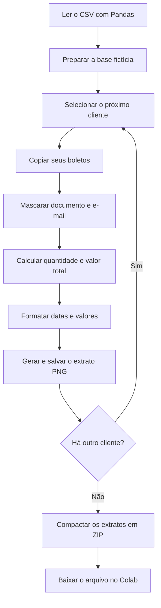

# Automação de extratos de boletos com Python

Projeto de portfólio que transforma uma base CSV em extratos visuais individuais, com CPF/CNPJ e e-mail parcialmente mascarados.

**Autor:** Lucas Freire Martins  
**Tecnologias:** Python, Pandas, Pillow e Matplotlib.

## Objetivo

Automatizar a preparação de extratos por cliente: separar os boletos, calcular a quantidade e o valor total, formatar os dados e gerar imagens padronizadas. O projeto simula uma tarefa operacional de relatórios e demonstra tratamento de dados com Python.

## Base de demonstração

A base é inteiramente fictícia e contém:

- 10 clientes: 5 pessoas físicas e 5 empresas.
- 100 boletos, com 5 a 15 por cliente e média de 10.
- 37 boletos pagos, 33 em aberto e 30 vencidos.
- Data de referência: **19/10/2026**.

Os documentos são identificadores fictícios para exercitar o mascaramento; não servem para testar validação de CPF/CNPJ. Os e-mails utilizam o domínio `example.com`.

## Fluxograma



O notebook começa com um exemplo para o cliente C001. Depois, repete o processamento para todos os clientes usando `groupby("cliente_id")`.

## O que o projeto faz

1. Lê o CSV com `pd.read_csv()`, preservando os zeros à esquerda dos documentos.
2. Corrige, quando presentes, as emissões futuras da versão inicial da base fictícia.
3. Separa os boletos de cada cliente e trabalha em uma cópia dos registros.
4. Exibe apenas os dois últimos caracteres do documento e a primeira letra do e-mail, mantendo o domínio.
5. Calcula a quantidade de boletos e a soma dos seus valores.
6. Formata datas como `dd/mm/aaaa` e valores como `R$ 1.250,00`.
7. Gera um PNG por cliente, com cartões de resumo e tabela em preto, amarelo e branco.
8. Reúne as imagens em um ZIP para download.

## Ferramentas utilizadas

| Ferramenta | Uso |
| --- | --- |
| Pandas | Leitura, seleção, agrupamento e tratamento dos dados |
| Pillow | Desenho dos cartões, textos e tabela; gravação dos PNGs |
| Matplotlib | Localização das fontes DejaVu incluídas na biblioteca |
| pathlib | Criação da pasta e construção dos caminhos dos arquivos |
| shutil | Compactação da pasta de extratos |
| Google Colab | Execução do notebook e download do ZIP |

O Matplotlib é utilizado para localizar as fontes, não para gerar gráficos.

## Arquivos do projeto

Para publicar o projeto, mantenha estes arquivos na raiz do repositório:

| Arquivo | Conteúdo |
| --- | --- |
| `README.md` | Documentação do projeto |
| `Impressao_de_boletos.ipynb` | Notebook com o passo a passo |
| `boletos_ficticios.csv` | Base de demonstração |

## Como executar no Google Colab

1. Baixe o notebook e o CSV deste repositório.
2. Abra o Google Colab e importe `Impressao_de_boletos.ipynb`.
3. No painel de arquivos, envie `boletos_ficticios.csv` para a pasta `/content/`.
4. Execute as células em ordem, desde a leitura do CSV.
5. Confira a prévia do primeiro cliente e execute a geração em lote.
6. Execute a última célula para compactar e baixar os extratos.

A leitura utiliza:

```python
import pandas as pd

df = pd.read_csv(
    "/content/boletos_ficticios.csv",
    sep=";",
    decimal=",",
    dtype={"cpf_cnpj": str}
)
```

O separador é ponto e vírgula e o separador decimal é vírgula. Os arquivos enviados ao ambiente do Colab são temporários e podem precisar ser reenviados em uma nova sessão.

Para gerar as imagens, execute primeiro a célula que configura as fontes e define a função `gerar_imagem()`.

## Resultados esperados

- Uma prévia individual em `/content/extrato_cliente.png`.
- 10 imagens na pasta `/content/extratos/`, de `extrato_C001.png` a `extrato_C010.png`.
- Um arquivo `/content/extratos_clientes.zip` contendo os extratos.

Exemplos de conferência na base fornecida:

| Cliente | Quantidade de boletos | Valor total |
| --- | ---: | ---: |
| C001 | 5 | R$ 3.492,82 |
| C010 | 15 | R$ 21.135,39 |

O valor total inclui todos os boletos do cliente, inclusive os pagos. Portanto, **não representa o saldo devedor**.

## Campos da base

| Campo | Descrição |
| --- | --- |
| `cliente_id` | Identificador do cliente |
| `nome` | Nome fictício do cliente ou empresa |
| `tipo_pessoa` | PF ou PJ |
| `cpf_cnpj` | Documento fictício armazenado como texto |
| `email` | E-mail fictício |
| `boleto_id` | Identificador único do boleto |
| `data_emissao` | Data de emissão |
| `data_vencimento` | Data de vencimento |
| `data_pagamento` | Data de pagamento, vazia nos boletos não pagos |
| `valor` | Valor do boleto em reais |
| `situacao` | Pago, Em aberto ou Vencido |
| `data_referencia` | Data de referência da simulação |

## Limites desta versão

- **Mascaramento parcial:** o CSV e as primeiras saídas do notebook preservam os dados de origem. O projeto não realiza anonimização completa.
- **Situação fornecida pela base:** os status não são recalculados conforme a data atual.
- **Ajuste específico da simulação:** 14 datas de emissão da base inicial estavam após a referência. A base corrigida limita essas emissões à data de referência; o notebook também trata a versão inicial. Essa regra não deve ser aplicada automaticamente a dados reais.
- **Layout simples:** a altura acompanha o número de boletos, mas não há paginação ou ajuste automático para textos muito longos.
- **Pasta reutilizada:** a geração substitui imagens com o mesmo nome, mas não remove arquivos de clientes ausentes em uma base nova. Confira a pasta antes de compactar outra base.
- Não há emissão bancária, registro de boletos, processamento de pagamentos ou envio de e-mails. Os arquivos são extratos visuais demonstrativos.

## Aprendizados

- Importação de CSV e preservação de tipos de dados.
- Seleção e agrupamento de registros com Pandas.
- Manipulação de textos e mascaramento de campos.
- Cálculo e formatação de indicadores simples.
- Uso de funções para reaproveitar o desenho do extrato.
- Geração de arquivos em lote e conferência dos resultados.

## Desenvolvimento

Projeto desenvolvido como exercício de aprendizagem, com apoio de IA na estruturação do código, na revisão e na resolução de problemas. A proposta é compreender cada etapa e evoluir a solução gradualmente.
